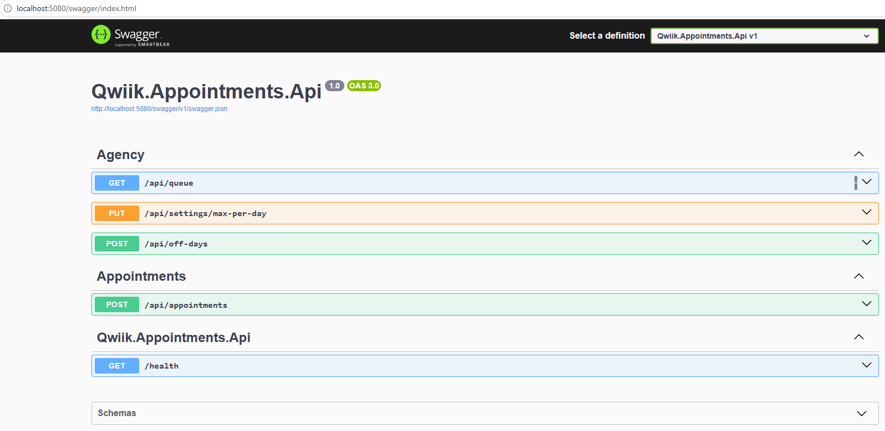

# Appointment Booking & Token Queue API

Web API that lets an agency book appointments for customers, issue queue tokens,
and view the queue (grid of customers with appointments) for a given day.

## Stack
.NET 8, ASP.NET Core Web API, EF Core + SQLite, Serilog, Swagger (Swashbuckle),
xUnit + Moq, Docker, GitHub Actions.

## Solution structure

## Run locally
```bash
dotnet run --project src/Qwiik.Appointments.Api --urls http://localhost:5080
```
- Swagger UI: http://localhost:5080/swagger (the root URL redirects there)

- Health check: http://localhost:5080/health
- The SQLite database (`appointments.db`) is created and migrated on startup.

### Docker
```bash
docker build -t qwiik-appointments .
docker run --rm -p 8080:8080 -v qwiik-data:/data qwiik-appointments
```

### Tests
```bash
dotnet test
```

## Endpoints
| Method | Path | Purpose |
|---|---|---|
| POST | /api/appointments | Book an appointment and issue a token |
| GET | /api/queue?date=yyyy-MM-dd | Queue grid for a day, ordered by token (defaults to today) |
| PUT | /api/settings/max-per-day | Set the maximum appointments per day |
| POST | /api/off-days | Register an off day (e.g. public holiday) |
| GET | /health | Liveness plus database connectivity |

Example:
```bash
curl -X POST localhost:5080/api/appointments -H 'Content-Type: application/json' \
  -d '{"name":"Budi","phone":"0812","date":"2026-10-20"}'
```

## Business rules and assumptions
- Tokens start at 1 each day and are issued in booking order.
- Default maximum is 20 appointments per day; the agency can change it.
- If the requested day is an off day or is full, the booking moves to the next day
  that is open and has capacity (up to 365 days ahead). The response sets
  `movedFromRequestedDate: true`.
- Dates in the past are rejected (400). "Today" is evaluated in Asia/Jakarta.
- Out of scope: authentication, cancelling appointments (the status exists in the model).

## How the demonstration points are covered
| Point | Where |
|---|---|
| Separation of Business and Web layers | Core (business) / Infrastructure (data) / Api (web) |
| Third-party libraries via NuGet | EF Core, Serilog, Swashbuckle, xUnit, Moq |
| IoC/DI ready (e.g. Autofac) | Constructor injection against interfaces, registered in `Program.cs`; switching to Autofac only changes the registration |
| LINQ | Queue mapping in `AgencyService`, queries in the repositories |
| API documentation with Swagger | `/swagger` |
| Unit tests | `tests/`, run with `dotnet test` |
| Web API | Controllers under `src/Qwiik.Appointments.Api/Controllers` |
| Source control with GitHub | This repository; CI builds, tests and builds the Docker image on every push |
| Azure hosting | The app is container-ready (see Dockerfile). Deployment to Azure is not part of this submission. |

## Concurrency
Token assignment reads the last token for the day and adds one, so simultaneous bookings
can race. A unique index on `(Date, TokenNumber)` guarantees no duplicate tokens.
The service retries up to 5 times with a short randomized backoff; if conflicts persist
the API returns 409. Details and the incident write-up are in `RUNBOOK.md`.

## Known limitations
- SQLite allows a single writer; a production deployment should use a server database
  (e.g. Azure SQL) with serializable transactions or a per-day counter row.
- No authentication or rate limiting.


# Runbook: Appointment Booking API

## 1. Health and quick checks
| Check | Command | Healthy |
|---|---|---|
| Service up | `curl -s localhost:5080/health` | `{"status":"Healthy"}` (503 means the database is unreachable) |
| API docs | open `/swagger` | page loads |
| Today's queue | `curl -s localhost:5080/api/queue` | JSON array |

## 2. Reading logs
Every request is assigned a correlation ID. It is returned in the `X-Correlation-ID`
response header, appears in every log line as `[<id>]`, and is included as
`correlationId` in error responses (RFC 7807 problem details).

1. Ask the reporter for the correlation ID (from the error body or header).
2. Search the log output for that ID to see the whole request, including exceptions.
3. Logs are written to the console (stdout): `docker logs <container>` in Docker.

## 3. Severity classification
| Level | Definition | Example | Target response |
|---|---|---|---|
| P1 Critical | Service down or no booking possible for anyone | `/health` returns 503, all bookings return 500 | Immediate |
| P2 High | Degraded for many users or incorrect data | Sustained 409/500 on booking, wrong token numbers, bookings landing on wrong dates | Within 1 hour |
| P3 Medium | One feature failing, workaround exists | Setting max per day or adding off days fails | Same business day |
| P4 Low | Cosmetic or documentation | Swagger text, typo in a message | Next sprint |

## 4. Common symptoms
| Symptom | Likely cause | Action |
|---|---|---|
| 400 on booking | Business rule (past date, blank name) or validation | Read `detail` in the response; not a server fault |
| 409 on booking | Concurrent booking conflict persisted after 5 retries | See section 5; check request volume on the same day |
| 500 | Unhandled exception | Find the correlation ID in the logs and read the stack trace |
| Booking moved to another day | Requested day is full or an off day | Expected; check `movedFromRequestedDate` and the off-day list |
| "Cannot book in the past" right after midnight | Server time zone mismatch | The app evaluates "today" in Asia/Jakarta; confirm the container has tzdata |

## 5. Example RCA: conflicting tokens under concurrent booking
Found during testing, not in production.

- **Impact:** Five simultaneous bookings for the same day returned 201, 201, 409, 409, 409.
  Valid customers were rejected while the day had capacity for 20.
- **Data integrity:** Not affected. The queue contained tokens 1 and 2 with no duplicates.
- **Root cause:** Token assignment is read-then-write (last token + 1). Parallel requests read
  the same value and tried to insert the same token. The unique index on `(Date, TokenNumber)`
  rejected the losers (SQLite constraint error), which the API mapped to 409.
- **Detection:** Parallel curl test; the 409 responses carried correlation IDs that were
  matched to the log lines showing the constraint failure.
- **Fix:** The repository translates the unique violation into `SlotConflictException` and
  clears the EF change tracker; `BookingService` retries up to 5 times with a randomized
  10 to 60 ms backoff, recomputing the token each time.
- **Verification:** Re-ran five parallel bookings for a new date.
  Result: <paste the five HTTP codes and the final queue here>
- **Prevention and remaining risk:** Retries cover small bursts only. Higher concurrency needs a
  database with proper row-level concurrency control (e.g. Azure SQL) and a serializable
  transaction or a per-day counter row. Alert on a sustained rise in 409 responses.

## 6. Known limitations
- SQLite: single writer, so heavy write load can cause "database is locked" errors.
- No authentication, no cancellation endpoint, no rate limiting.